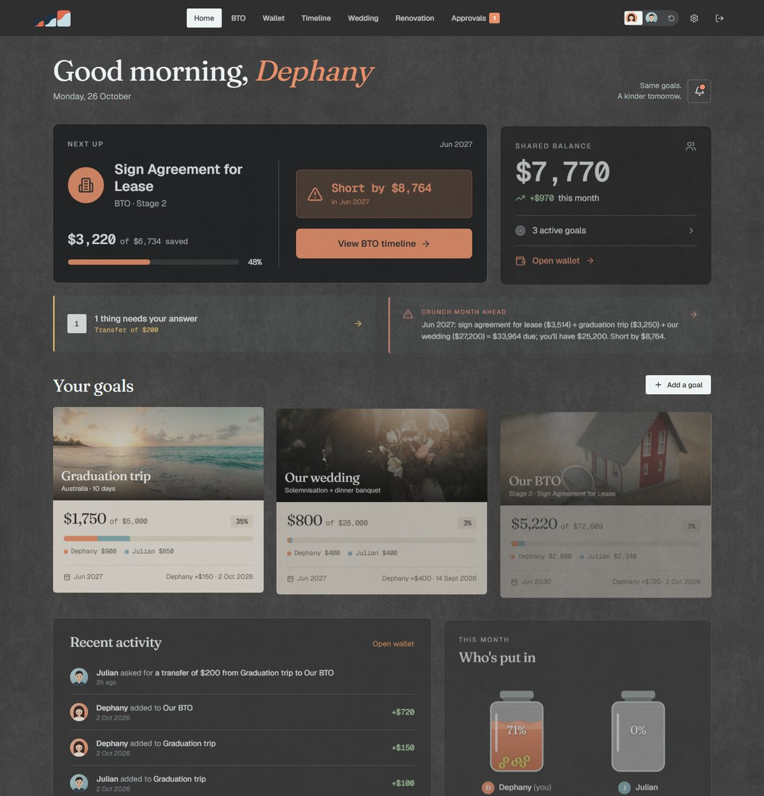
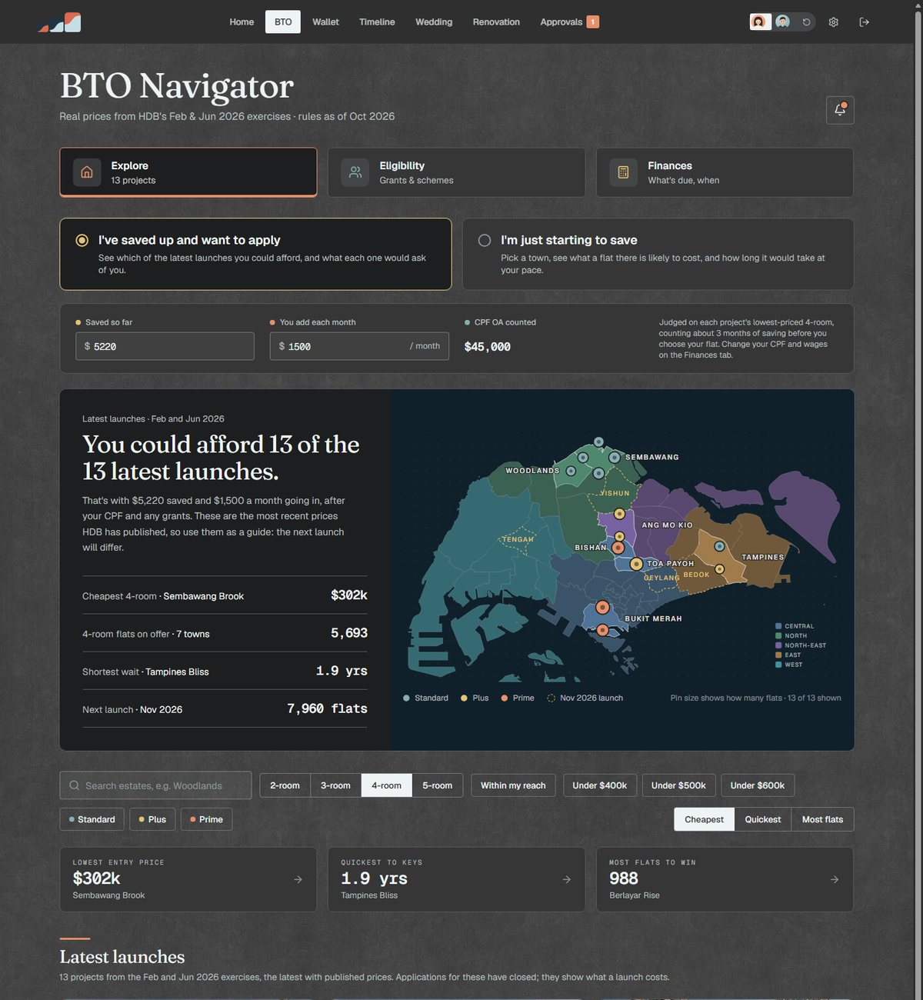
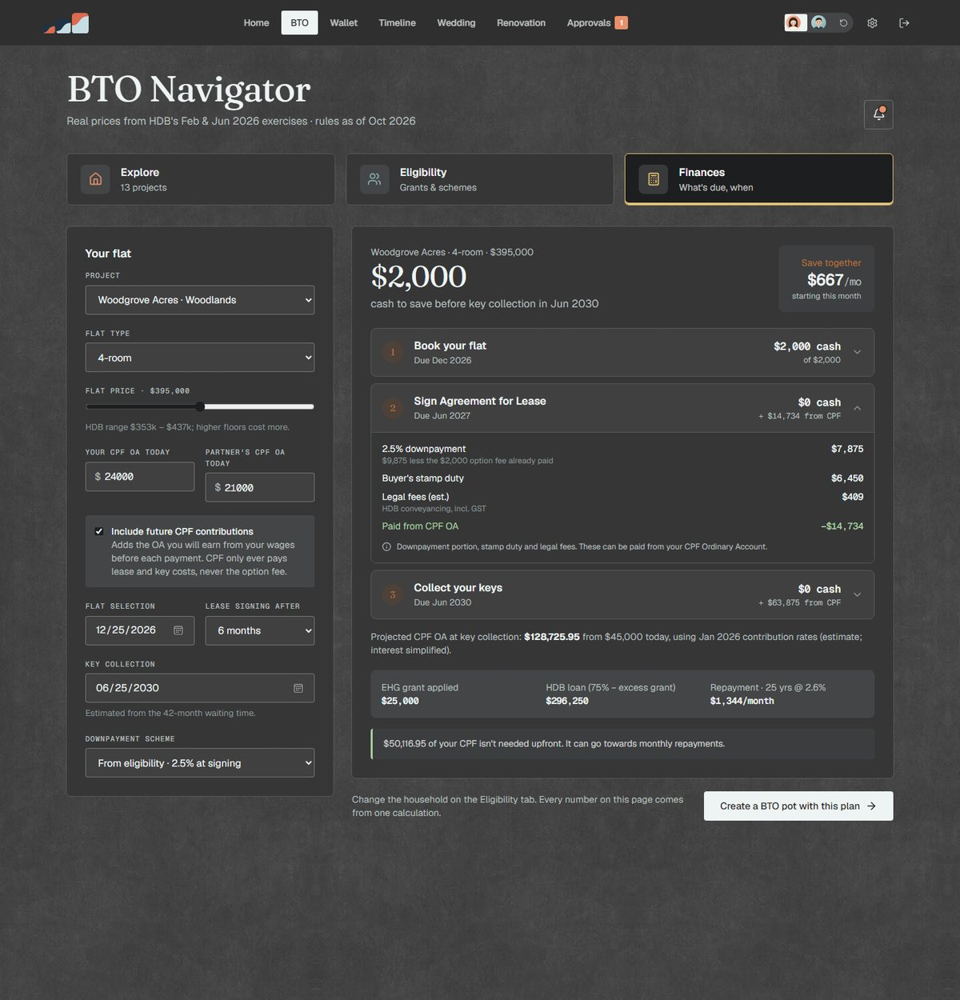

# SMilestones

A shared savings and planning workspace for Singapore couples. It plans the big milestones (a BTO flat, the wedding, the renovation, trips) around real HDB and CPF numbers, and keeps both partners honest with each other.

Built with Vue 3, TypeScript, Vite and Tailwind v4. Supabase (Postgres, Auth, row-level security) sits behind Vercel functions. The full app also runs with no backend at all, as a demo that stores its data in the browser.

<!-- Live demo: add the deployed link here once it is on Vercel. -->



## What it does

| | |
|---|---|
| **BTO Navigator** | Real prices and wait times from HDB's Feb and Jun 2026 launches, on a map drawn from URA's planning-area boundaries. Two ways in: *I've saved up* shows which launches you could afford; *I'm just starting* picks a town and works out when your saving would get you there. |
| **Finances** | The three BTO payments (option fee, signing, keys) with CPF and grants applied, a loan estimate, and the exact cash to save by each date. |
| **Wallet and goals** | Shared goals with a monthly split both partners agree. Every balance is derived from a ledger. |
| **Timeline** | Pools what you have agreed to save against what falls due each month, and flags crunch months with two ways to fix them. |
| **Approvals** | Withdrawals and transfers between goals need the other partner to approve. |
| **Wedding and renovation** | Researched guides and directories of 169 and 71 vendors, plus budgets that feed straight into a savings goal. |
| **Fluffy** | A shared pet that grows only when you actually save. |



## Engineering notes

**One engine, two runtimes.** Every write is a command run by a single pure function, `src/domain/engine.ts`. The browser runs it for the demo (state in localStorage). The server runs the same code for cloud mode and commits each command in one transaction with optimistic locking. Nothing is implemented twice.

**Money is integer cents.** Balances, progress, streaks and the timeline are derived from the ledger and never stored, so editing or voiding a contribution fixes everything downstream.

**Affordability is judged per payment, not against a lump sum.** The cost of a flat falls due in three stages, years apart, while savings and CPF keep growing. `src/domain/btoReadiness.ts` checks the savings the couple *will* have at each due date. An earlier version asked whether they could pay the $2,000 option fee today, to the dollar, which made $1,999 fail and $2,000 pass. The fix, and a regression test for it, is in the history.

**Rates are named constants with a source.** CPF contribution rates, wage ceilings, HDB loan terms and grants each carry an as-of date and a link, so they are easy to re-check every January.

**Security is enforced twice.** The engine refuses what a user may not do, and Postgres row-level security backs it up. A parent can be invited to one goal as a contributor, and the tests prove they cannot read other goals, requests, splits or incomes, or approve anything.

**Bank statements never leave the browser.** Reconciliation parses the CSV locally and stores only a `verified` flag on matched contributions.



## Run it

```bash
npm install
npm run dev          # http://localhost:5173, then try the demo (no setup needed)
npm test             # 156 tests: domain, engine, CPF, BTO, and the schema on Postgres (PGlite)
npm run typecheck
npm run build
```

Cloud mode needs the keys in `.env.example` and the migrations in `supabase/migrations/` applied in order (0001 to 0009). `vercel dev` runs the API locally.

## Project layout

```
src/domain/      pure logic: engine, BTO plan, CPF, readiness, timeline, covers, reconcile
src/data/        BTO projects, directories, guides, planning-area map shapes, demo seed
src/components/  UI, grouped by feature (navigator, pot, guide, art)
src/stores/      app state (demo or cloud) and guide state
api/             Vercel functions: command, snapshot, invite, join, profile
supabase/        migrations and row-level security
tests/           one file per area; pg.test.ts runs the real migrations in-process
```

## Data sources and credits

- **BTO prices and wait times:** HDB sales-launch annexes, [Feb 2026](https://www.hdb.gov.sg/-/media/hdb-pulse/news/2026/hdb-launches-9012-flats-in-february-2026-bto-and-sbf-exercises/Annex-A.pdf) and [Jun 2026](https://www.hdb.gov.sg/-/media/hdb-pulse/news/2026/20260617-HDB-Launches-6952-Flats-Across-7-Projects-in-June-2026-BTO-Sales-Exercise/Annex-A.pdf), transcribed by hand into `src/data`.
- **Project images:** artist's impressions published by HDB, shown with an "Artist's impression · HDB" label. They belong to HDB and are used here for illustration.
- **Map:** URA Master Plan 2019 Planning Area Boundary (No Sea), from [data.gov.sg](https://data.gov.sg), under the Singapore Open Data Licence. Simplified and projected for the page.
- **CPF:** contribution and allocation rates from [cpf.gov.sg](https://www.cpf.gov.sg), as of Jan 2026.
- **Other photography:** stock images in `public/images`. Check their licences before publishing the project more widely.

## Assumptions and limits

- Everything is an **estimate**, not financial advice. A HDB Flat Eligibility letter is the final word on grants and loans.
- Planning ahead assumes BTO prices rise **3% a year**. That is a placeholder chosen for illustration, not an HDB figure (`ASSUMED_PRICE_GROWTH` in `btoReadiness.ts`).
- For a launch that is open, the affordability check allows **3 months** of saving between applying and choosing a flat (`APPLY_TO_SELECTION_MONTHS`). Also an assumption.
- The CPF projection keeps wages flat and ignores bonuses. Its simplifications are listed at the top of `src/domain/cpf.ts`.
- BTO data stops at the Jun 2026 exercise. The Nov 2026 launch is shown as "next" with no prices, because HDB has not published them.
- The demo couple is placeholder data.

## Licence

MIT, see [LICENSE](LICENSE).
